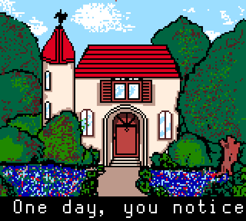
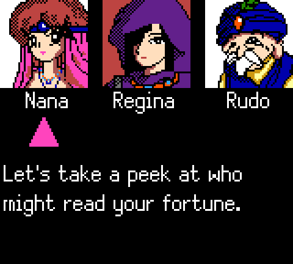
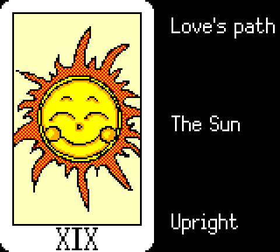

# House of Tarot (Game Gear) - English Translation

English translation patch for ハウス・オブ・タロット (House of Tarot), a 1991 Sega Game Gear
tarot-reading program. As far as we know, this is the first English translation.

 

 

## About the game

There is nothing to play or win; it is a fortune-telling program. You visit a mysterious
house, choose one of three fortune tellers (Nana for love, Regina for work and studies,
Rudo the old sage), give your zodiac sign, shuffle the 22 Major Arcana and receive a spread.
Each card is interpreted for the position it landed in, upright or reversed.

## What the patch does

- Translates all of the game's text: every reading, the zodiac readings, menus, prompts,
  the intro and the credits.
- Replaces the Japanese font with a proportional English one and rewrites the text engine
  to use it, so readings fit the screen without extra pages.
- Expands the ROM from 128 KB to 256 KB.

## Applying the patch

Download the `.bps` (or `.ips`) file from the
[Releases page](https://github.com/LegendaryDoors/house-of-tarot-english/releases).

The easiest way to apply it is [Rom Patcher JS](https://www.marcrobledo.com/RomPatcher.js/)
in your browser: load your ROM and the patch, then click Apply. On the desktop, Floating
IPS or beat apply the `.bps`; Lunar IPS applies the `.ips`.

The patch is made for the Japanese ROM `House of Tarot (1991)(Sega)(JP)` (128 KB, CRC32
`57834C03`); the `.bps` refuses anything else. Full checksums are in `checksums.txt` on the
release. Play the patched ROM in any Game Gear emulator or on a flash cart.

## Building from source

Put the ROM at the repository root as `House of Tarot (J).gg`, install Python 3 with Pillow
and numpy, and run:

    python3 tools/hot_text.py      # dump the original messages
    python3 tools/hot_build.py     # build the translated ROM
    python3 tools/hot_patch.py     # write the .ips/.bps patches and checksums

Report problems as issues on this repository.

## Credits

Original game: Sega, 1991. This is an unofficial fan work. The patch contains only the
translated text, the font and the changed bytes; you need your own copy of the game.
